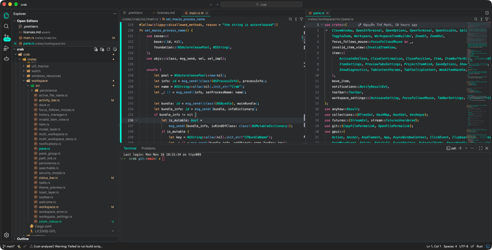

<p align="center">English | <a href="README.vi.md">Tiếng Việt</a></p>

**Crab** is a native code editor and agent workspace written in Rust, maintained at [ntm-dev/crab](https://github.com/ntm-dev/crab). Releases, the install script and auto-update all come from this repository.

---

<div align="center">
  
  <h1>Crab</h1>
  <p>The fast, native code editor and agent workspace.</p>
  <p>Written in Rust. Batteries included.</p>
  <p><a href="#download"><strong>Download</strong></a></p>
</div>

---

Crab is a fast, native code editor written in Rust, with a clean, modern design and coding agents built in. Crab is a fork of [Zed](https://github.com/zed-industries/zed) but diverges heavily from it.

## Features

- ⚡ **Native and fast.** No Electron or webviews. Opens instantly and stays responsive on large views.
- 🍃 **Lightweight.** Crab's memory footprint is lower than VS Code and Zed. See [benchmarks](https://github.com/ntm-dev/crab/blob/main/docs/memory-benchmark.md).
- 👾 **Coding agents included.** Built-in support for Claude Code, Codex, and OpenCode.
- ✨ **Beautiful by default.** Clean, modern look with a delightful UX.
- 🤫 **No account or telemetry.** Nothing to sign in to. Crab never sends your usage data anywhere.

## Download

On macOS and Linux, run:

```sh
curl -fsSL https://raw.githubusercontent.com/ntm-dev/crab/main/script/install.sh | sh
```

For Windows, download the [installer](https://github.com/ntm-dev/crab/releases/latest/download/Crab-x86_64.exe).

<details>
<summary>Or install manually</summary>

- [macOS (Apple Silicon)](https://github.com/ntm-dev/crab/releases/latest/download/Crab-aarch64.dmg)
- [macOS (Intel)](https://github.com/ntm-dev/crab/releases/latest/download/Crab-x86_64.dmg)
- [Windows x86-64](https://github.com/ntm-dev/crab/releases/latest/download/Crab-x86_64.exe)
- [Linux x86-64](https://github.com/ntm-dev/crab/releases/latest/download/crab-linux-x86_64.tar.gz)
- [Linux AArch64](https://github.com/ntm-dev/crab/releases/latest/download/crab-linux-aarch64.tar.gz)

See [INSTALL.md](https://github.com/ntm-dev/crab/blob/main/docs/INSTALL.md) for more.
</details>

---



## Docs

See [docs](https://github.com/ntm-dev/crab).

## Building

Crab builds the same way Zed does. See the [Zed development docs](https://zed.dev/docs/development).

## Licensing

Crab is licensed under GPL-3.0-or-later with Apache-2.0 components where marked. See [LICENSE-GPL](./LICENSE-GPL) and [LICENSE-APACHE](./LICENSE-APACHE).

## Acknowledgements

Thanks to the Zed team for building an excellent editor and releasing it as open source. Crab would not exist without their work.
