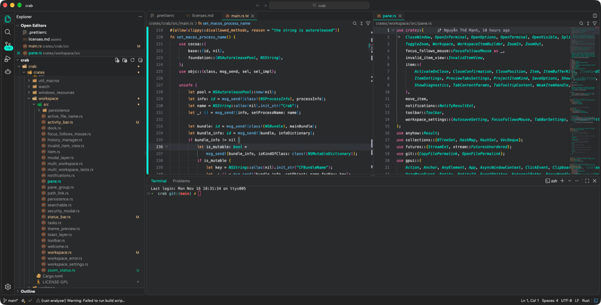

<p align="center"><a href="README.md">English</a> | Tiếng Việt</p>

**Crab** là trình soạn thảo mã nguồn gốc (native) và không gian làm việc cho agent, viết bằng Rust, được duy trì tại [ntm-dev/crab](https://github.com/ntm-dev/crab). Bản phát hành, script cài đặt và tự động cập nhật đều lấy từ repo này.

---

<div align="center">
  
  <h1>Crab</h1>
  <p>Trình soạn thảo mã nguồn gốc (native) nhanh và không gian làm việc cho coding agent.</p>
  <p>Viết bằng Rust. Đầy đủ tính năng.</p>
  <p><a href="#tải-về"><strong>Tải về</strong></a></p>
</div>

---

Crab là trình soạn thảo mã nguồn gốc, nhanh, viết bằng Rust, với thiết kế sạch sẽ, hiện đại và có sẵn các coding agent. Crab là bản fork của [Zed](https://github.com/zed-industries/zed) nhưng đã khác biệt rất nhiều so với bản gốc.

## Tính năng

- ⚡ **Gốc và nhanh.** Không dùng Electron hay webview. Mở ngay lập tức và vẫn mượt trên các tệp lớn.
- 🍃 **Nhẹ.** Crab dùng ít bộ nhớ hơn VS Code và Zed. Xem [kết quả đo](https://github.com/ntm-dev/crab/blob/main/docs/memory-benchmark.md).
- 👾 **Có sẵn coding agent.** Hỗ trợ tích hợp Claude Code, Codex và OpenCode.
- ✨ **Đẹp ngay từ đầu.** Giao diện sạch, hiện đại, trải nghiệm dễ chịu.
- 🤫 **Không cần tài khoản, không telemetry.** Không phải đăng nhập. Crab không bao giờ gửi dữ liệu sử dụng của bạn đi đâu cả.

## Tải về

Trên macOS và Linux, chạy:

```sh
curl -fsSL https://raw.githubusercontent.com/ntm-dev/crab/main/script/install.sh | sh
```

Trên Windows, tải [trình cài đặt](https://github.com/ntm-dev/crab/releases/latest/download/Crab-x86_64.exe).

<details>
<summary>Hoặc cài thủ công</summary>

- [macOS (Apple Silicon)](https://github.com/ntm-dev/crab/releases/latest/download/Crab-aarch64.dmg)
- [macOS (Intel)](https://github.com/ntm-dev/crab/releases/latest/download/Crab-x86_64.dmg)
- [Windows x86-64](https://github.com/ntm-dev/crab/releases/latest/download/Crab-x86_64.exe)
- [Linux x86-64](https://github.com/ntm-dev/crab/releases/latest/download/crab-linux-x86_64.tar.gz)
- [Linux AArch64](https://github.com/ntm-dev/crab/releases/latest/download/crab-linux-aarch64.tar.gz)

Xem thêm tại [INSTALL.md](https://github.com/ntm-dev/crab/blob/main/docs/INSTALL.md).
</details>

---



## Tài liệu

Xem [tài liệu](https://github.com/ntm-dev/crab).

## Build

Crab được build giống như Zed. Xem [tài liệu phát triển của Zed](https://zed.dev/docs/development).

## Giấy phép

Crab được cấp phép theo GPL-3.0-or-later, với các thành phần Apache-2.0 ở những phần có ghi chú. Xem [LICENSE-GPL](./LICENSE-GPL) và [LICENSE-APACHE](./LICENSE-APACHE).

## Lời cảm ơn

Cảm ơn đội ngũ Zed đã xây dựng một trình soạn thảo xuất sắc và mở mã nguồn nó. Không có công sức của họ thì sẽ không có Crab.
